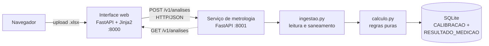

# Automação de Certificados de Calibração — MVP (AV03, Parte 1)

**Projeto Aplicado III · UniSENAI Blumenau · Prof. MSc. Hugo Menezes Barra · Empresa parceira: Schulz S.A.**
**Grupo 45:** Daniel Paulo Linhares · Gabriel da Silva Marques · Guilherme Bianchini Giovanela · Leandro Régis da Silva

Aplicação web transacional que **recebe uma planilha Excel (.xlsx)** com as leituras do instrumento e os
valores do padrão, **calcula** a média, o erro sistemático e a validação por ponto contra o LEA e
**apresenta o parecer final** (APROVADO / REPROVADO) numa interface simples.

## Regras de negócio implementadas (roteiro AV03 — Item 1)

| Etapa | Regra |
|---|---|
| Média das leituras | `média = Σ leituras / n`, por ponto de ensaio |
| Erro sistemático | `erro = média − valor padrão` |
| Validação por ponto | `DENTRO_DA_TOLERANCIA` se `\|erro\| ≤ LEA`; senão `FORA_DA_TOLERANCIA` |
| Parecer final | `APROVADO` se **todos** os pontos estão dentro; `REPROVADO` se algum ponto está fora |

Detalhes que o código trata (todos cobertos por testes):

* **LEA assimétrico:** quando a planilha traz `Tol. +` e `Tol. −` diferentes (formato Schulz/Calypso), usa-se o LEA do lado em que o erro está. Com tolerância simétrica, reduz-se exatamente à regra do roteiro.
* **Margem de ponto flutuante (1×10⁻⁷ mm)**, conforme a Aula 02 — evita reprovar um valor que está exatamente no limite por ruído de arredondamento.
* **Saneamento de XLSX** (`reparar_xlsx_stream`, Aula 02): arquivos em formato OOXML *strict* (como os gerados por sistemas legados) têm os namespaces corrigidos em memória antes da leitura.
* **Leitura tolerante:** localiza o cabeçalho pela palavra-chave ("Parâmetro", "Ponto"…), ignora rodapés/notas e resíduos numéricos, aceita vírgula decimal, datas seriais do Excel e placeholders (`----`, `???`, `#VALUE!`).
* Formatos aceitos: **modelo simples**, **Registro da Schulz** (`Valor nominal / Tol. + / Tol. − / Medida 1 / Medida 2`) e **Relatório do Calypso** (duas rodadas de medição).

## Arquitetura



Dois microsserviços independentes que conversam por HTTP/JSON:

| Serviço | Pasta | Responsabilidade |
|---|---|---|
| **Metrologia (API REST)** | `services/metrologia` | Ingestão, cálculo, persistência transacional e contrato OpenAPI |
| **Interface web (BFF)** | `services/web` | Upload, tela de resultado/parecer, histórico; não contém regra de negócio |

O módulo `calculo.py` é **puro** (sem arquivo, banco ou HTTP). Foi pensado para virar uma função
serverless (AWS Lambda) conforme a arquitetura em nuvem definida na AV02; a persistência em SQLite
segue o Dicionário de Dados da AV01 (`CALIBRACAO` e `RESULTADO_MEDICAO`) e seria trocada por DynamoDB na nuvem.

### Endpoints da API (`http://127.0.0.1:8001/docs` — Swagger)

| Método | Rota | Descrição |
|---|---|---|
| `POST` | `/v1/analises` | Envia a planilha (`multipart`, campo `arquivo`), calcula e grava. Responde `201` |
| `GET` | `/v1/analises` | Lista as análises (mais recentes primeiro; `limite`, `deslocamento`) |
| `GET` | `/v1/analises/{id}` | Consulta uma análise completa |
| `GET` | `/v1/modelo-planilha` | Baixa o modelo de planilha de entrada |
| `GET` | `/health` | Verificação de saúde |

Erros seguem um contrato único `{"erro": {"codigo", "mensagem", "detalhes"}}` com `400` (arquivo ilegível),
`413` (> 5 MB), `422` (planilha sem layout reconhecido / dados incompletos) e `404`.

## Como executar

Requisitos: **Python 3.11+** (testado em 3.13).

```bash
git clone https://github.com/leandroregisdasilva-sys/AV-03---Constru-o-do-MVP-.git
cd schulz-certificados-mvp
python -m venv .venv && source .venv/bin/activate      # Windows: .venv\Scripts\activate
pip install -r requirements.txt
python scripts/run_local.py
```

Abra **http://127.0.0.1:8000**, escolha uma planilha da pasta `exemplos/` e clique em *Processar planilha*.
O banco SQLite é criado em `data/metrologia.db` (variável `METROLOGIA_DB` para mudar).

## Testes

```bash
pip install -r requirements-dev.txt
pytest                      # 118 testes (+ 2 que exigem planilhas reais, ignorados por padrão)
pytest -m e2e               # sobe os dois serviços de verdade e testa pela rede
pytest --cov=services       # cobertura (≈ 92 %)
SCHULZ_DADOS_REAIS=/pasta/com/planilhas pytest -m real   # opcional, local
```

| Arquivo | O que cobre |
|---|---|
| `tests/test_calculo.py` | Média, erro, LEA simétrico/assimétrico, limites, ponto flutuante, parecer, propriedade contra oráculo `Decimal` |
| `tests/test_ingestao.py` | Leitura dos 3 formatos, sinônimos de cabeçalho, rodapés, XLSX *strict*, arquivos inválidos |
| `tests/test_api.py` | Contrato HTTP, persistência, paginação, erros 400/404/413/422, modelo de planilha |
| `tests/test_web.py` | Páginas, parecer verde/vermelho, histórico, serviço fora do ar |
| `tests/test_e2e.py` | Fluxo completo com os dois serviços reais |

Os prints de funcionamento estão em [`docs/evidencias/`](docs/evidencias) e foram gerados por
`python scripts/capturar_evidencias.py`.

## Planilhas de exemplo

`exemplos/` contém planilhas **fictícias** (geradas por `scripts/gerar_exemplos.py`): uma aprovada, uma
reprovada, um relatório no estilo Calypso e um registro no estilo Schulz em formato *strict*.
**Nenhuma planilha real da Schulz é versionada** (`.gitignore`), por tratar-se de dados do cliente.

## Estrutura

```
services/metrologia/metrologia_service/   calculo.py · ingestao.py · repositorio.py · main.py · schemas.py · modelo.py
services/web/web_ui/                      main.py · templates/ · static/
tests/                                    suíte automatizada
scripts/                                  run_local.py · gerar_exemplos.py · capturar_evidencias.py
exemplos/  docs/evidencias/               planilhas fictícias e prints
```

## Limitações conhecidas (MVP)

* Sem autenticação e sem perfis (previstos na AV02 com Cognito/IAM).
* Não emite o PDF do certificado nem calcula a incerteza expandida (EA-4/02): escopo das próximas etapas.
* O parecer segue a regra simplificada do roteiro (`|erro| ≤ LEA`). Nas planilhas reais da Schulz, os pontos de
  **POSIÇÃO** ficam acima do LEA e o MVP os marca como `FORA_DA_TOLERANCIA`, embora o certificado atual da Schulz
  apenas **relate** o erro, sem declarar conformidade. Vale validar esta regra com o laboratório.
